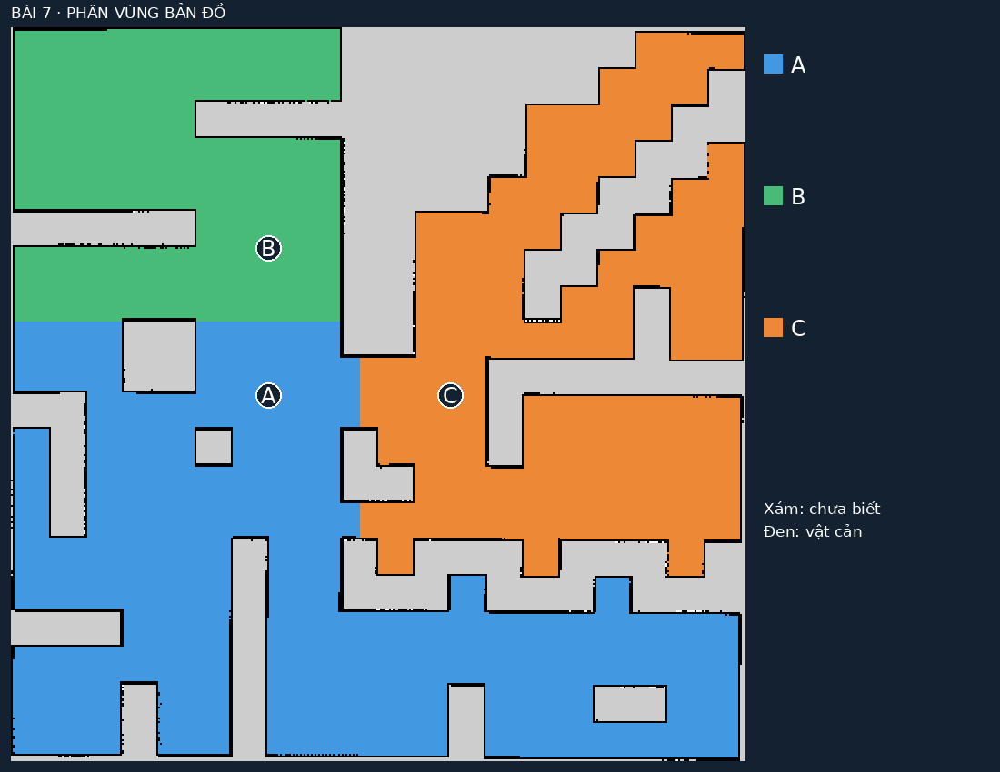
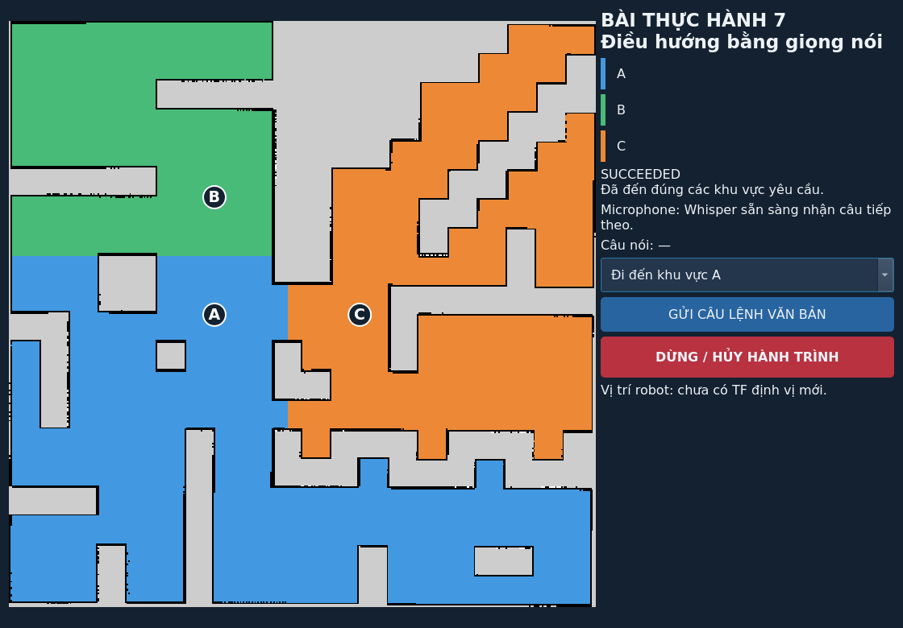

# Bài 7 — Phân vùng bản đồ và điều hướng TurtleBot 4 bằng giọng nói

Điều khiển TurtleBot 4 Lite trong Gazebo bằng **microphone laptop**. Hệ thống
phân vùng bản đồ thành **A, B, C**, nhận dạng tiếng Việt bằng Whisper offline
và gửi mục tiêu cho Nav2. Lệnh “Di chuyển từ khu vực A đến khu vực B” tạo hành
trình qua A trước, sau đó mới đến B.

**Môi trường:** Ubuntu 22.04, ROS 2 Humble, Gazebo Fortress, TurtleBot 4 Lite.



[Hướng dẫn chi tiết](README_VOICE_NAV.md) ·
[Báo cáo kiểm chứng](docs/VOICE_NAV_VALIDATION.md) ·
[Mã nguồn Bài 7](src/turtlebot4_voice_nav)

## Chức năng

- Phân vùng Occupancy Grid bằng OpenCV và Dijkstra đa nguồn trên ô trống.
- Hiển thị nhãn **A, B, C** trên bản đồ, RViz và giao diện.
- Kiểm tra điểm đích hợp lệ, cách vật cản/vùng chưa biết tối thiểu 0.30 m.
- Nhận lệnh trực tiếp từ mic laptop bằng Whisper Small tiếng Việt offline.
- Điều hướng từng chặng bằng action `NavigateToPose`; tự undock khi cần.
- Báo khu vực không tồn tại, câu không hiểu, độ tin cậy thấp và trạng thái bận.
- Hủy hành trình bằng câu “Dừng lại” hoặc nút **DỪNG** trên giao diện.

## Cài đặt

Máy cần cài [ROS 2 Humble trên Ubuntu 22.04](https://docs.ros.org/en/humble/Installation/Ubuntu-Install-Debians.html)
và có giao diện desktop để mở Gazebo/RViz. Cài các phụ thuộc:

```bash
sudo apt update
sudo apt install git python3-venv python3-pip python3-colcon-common-extensions \
  python3-opencv python3-numpy python3-yaml python3-pil python3-pyqt5 \
  python3-pytest libportaudio2 \
  ros-humble-turtlebot4-simulator ros-humble-irobot-create-nodes \
  ros-humble-slam-toolbox ros-humble-navigation2 ros-humble-nav2-bringup
```

Clone vào một workspace riêng, tải thư viện/mô hình giọng nói và build hai
package cần cho Bài 7:

```bash
git clone https://github.com/linhnghu/turtlebot4-voice-navigation.git ~/ros2_voice_ws
cd ~/ros2_voice_ws
./setup_voice_nav.bash
source /opt/ros/humble/setup.bash
colcon build --symlink-install --packages-select turtlebot4_lab turtlebot4_voice_nav
```

Setup tạo `.venv-voice-nav` và tải mô hình Whisper Small đa ngôn ngữ khoảng
500 MB. Internet cần cho lần cài đặt đầu; nhận dạng chạy cục bộ sau khi đã có
mô hình. Model, virtualenv và thư mục build không được đưa vào Git.

## Chạy bằng micro laptop

```bash
cd ~/ros2_voice_ws
./run_voice_nav.bash
```

Lệnh này mở **Gazebo + RViz + giao diện bản đồ + microphone**. Trong Ubuntu
**Settings → Sound → Input**, chọn **Internal Microphone**. Đợi robot ở trạng
thái **READY** và dòng microphone báo sẵn sàng, rồi nói:

| Câu nói | Hành vi |
|---|---|
| “Đi đến khu vực A.” | Điều hướng đến A |
| “Đi đến khu vực B.” | Điều hướng đến B |
| “Đi đến khu vực C.” | Điều hướng đến C |
| “Di chuyển từ khu vực A đến khu vực B.” | Đi qua A rồi đến B |
| “Đi đến khu vực Z.” | Báo `UNKNOWN_REGION` |
| “Dừng lại.” | Hủy action và các chặng còn lại |

Nói rõ một câu, ngừng ít nhất 0.8 giây và đợi xử lý xong trước câu tiếp theo.
Câu nhận được xuất hiện ở dòng **Nghe**. Bộ nhận dạng cũng hỗ trợ cách đọc
“khu vực bê”, “khu vực xê”. Nhãn hiển thị chỉ gồm A/B/C.

Whisper cần thời gian xử lý; nút **DỪNG** gửi yêu cầu hủy trực tiếp khi cần.
Ctrl+C ở terminal launch hoặc chạy `./stop_turtlebot4.bash` để đóng phiên.



Trong mỗi terminal phụ, nạp đúng ROS domain của Bài 7:

```bash
cd ~/ros2_voice_ws
source voice_nav_env.bash
```

Mặc định dùng domain **57**, ROS localhost và Gazebo partition riêng.
`turtlebot4_env.bash` chuẩn bị cấu hình Ogre2 cho LiDAR của simulator.

## Tùy chọn thường dùng

```bash
# Kiểm tra bằng ô nhập câu lệnh trên GUI:
./run_voice_nav.bash voice:=false

# Chọn microphone theo số device PortAudio:
./run_voice_nav.bash device:=2

# Chạy server mô phỏng không mở cửa sổ:
./run_voice_nav.bash voice:=false gazebo_gui:=false rviz:=false dashboard:=false

# Điều chỉnh ngưỡng âm thanh nếu tiếng nền gây khó tách câu:
./run_voice_nav.bash energy_threshold:=500.0
```

Mỗi lần chỉ chạy một phiên. Xem phần [thiết bị âm thanh](README_VOICE_NAV.md#thiết-bị-âm-thanh)
để chọn mic, kiểm tra clipping và giảm Mic Boost khi cần.

## Bản đồ và khu vực

Map mẫu nằm ở `maps/map.yaml` và `maps/map.pgm`, khớp world `maze`.
[`seeds.yaml`](src/turtlebot4_voice_nav/config/seeds.yaml) chứa ID, alias,
hạt giống, yaw và màu. Tọa độ đích trong frame `map`:

| Nhãn | x (m) | y (m) |
|---|---|---|
| A | -3.0 | 0.0 |
| B | -3.0 | 4.0 |
| C | 2.0 | 0.0 |

Launch tự tạo `regions.yaml`, `labels.npy` và ảnh màu trong `artifacts/voice_nav`.
Đây là phân vùng bán tự động từ hạt giống người dùng chọn, không tự suy luận
loại phòng. Phần chuyển pixel sang tọa độ ROS có xét resolution và origin yaw.
Nav2 dùng costmap để lập kế hoạch và tránh vật cản trong lúc robot di chuyển.

## Kiểm thử và bằng chứng

```bash
source voice_nav_env.bash
python3 -m pytest -q src/turtlebot4_voice_nav/test
```

**52 unit test đã đạt**, gồm phân vùng, chuyển tọa độ, parser tiếng Việt, khu
vực không tồn tại, lệnh phủ định, thứ tự chặng, hủy action và retry lifecycle.

Các báo cáo runtime đã lưu:

- [Nav2 qua lệnh văn bản](artifacts/voice_nav/navigation_validation.json): A → B,
  đến các đích, khu vực sai, BUSY, hủy và odometry dừng; 0 bumper trong lượt này.
- [Nhận dạng WAV](artifacts/voice_nav/speech/speech_validation.json): 3/3 mẫu đạt.
- [WAV → Whisper → ROS → Nav2](artifacts/voice_nav/voice_pipeline_validation.json):
  cả ba điểm A/B/C trả `SUCCEEDED`.
- [Thiết lập microphone laptop](artifacts/voice_nav/microphone_setup_20261110.json):
  đã kiểm tra đường thu thật và giảm mức khuếch đại gây clipping.

WAV kiểm chứng là giọng tổng hợp; báo cáo không thay thế thử trực tiếp ba câu
bằng giọng người dùng. Mẫu WAV dùng các alias tên đầy đủ trong cấu hình;
các câu A/B/C cần đánh giá thêm theo giọng nói và tiếng nền thực tế.
Giới hạn và kết quả chi tiết ở [báo cáo kiểm chứng](docs/VOICE_NAV_VALIDATION.md).

Khi simulator đang READY, có thể chạy riêng các kiểm tra runtime sau (robot
mô phỏng sẽ di chuyển):

```bash
python3 src/turtlebot4_voice_nav/test/check_navigation.py
python3 src/turtlebot4_voice_nav/test/check_voice_pipeline.py
```

## Mã nguồn và tài liệu

| Đường dẫn | Nội dung |
|---|---|
| `src/turtlebot4_voice_nav/` | Phân vùng, Whisper/Vosk, parser, Nav2, GUI, launch và test Bài 7 |
| `src/turtlebot4_lab/` | Simulator, AMCL/Nav2, RViz và kiểm tra topic |
| `maps/` | Bản đồ mẫu maze |
| `artifacts/voice_nav/` | Bản đồ phân vùng, ảnh GUI, fixture WAV và báo cáo kiểm chứng |
| `README_VOICE_NAV.md` | Thiết kế, ROS interface, cấu hình và troubleshooting |
| `docs/VOICE_NAV_VALIDATION.md` | Phương pháp và giới hạn kiểm chứng |

Repo giữ các package thực hành đã có trong workspace: gesture, vision/Nav2,
multimodal HRI, engagement và object reference. Các package này có tài liệu
riêng và không cần build để chạy Bài 7.

## Giấy phép và tham khảo

Mã nguồn dự án: [Apache-2.0](LICENSE). Tài nguyên mô hình người đi kèm có
[ghi nguồn riêng](src/turtlebot4_vision_nav/models/ATTRIBUTION.md).

- [TurtleBot 4 Simulator](https://github.com/turtlebot/turtlebot4_simulator/tree/humble)
- [Nav2](https://docs.nav2.org/)
- [faster-whisper](https://github.com/SYSTRAN/faster-whisper)
- [Vosk models](https://alphacephei.com/vosk/models)
