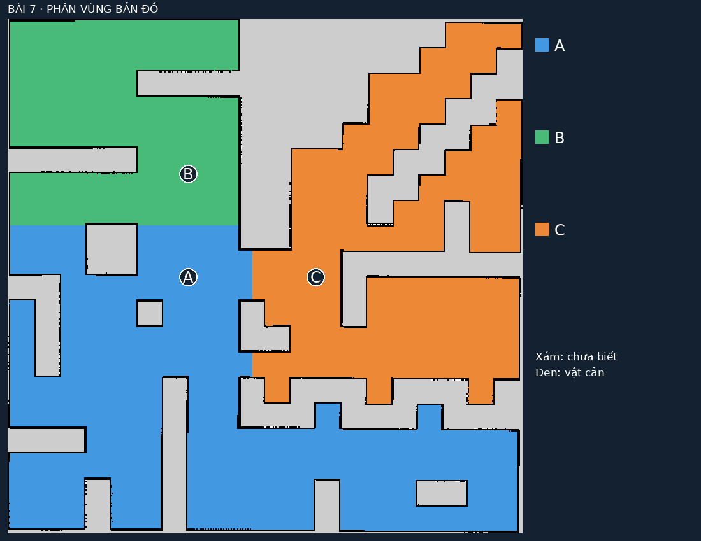

# Bài thực hành 7 — Phân vùng bản đồ và điều hướng bằng giọng nói

ROS 2 Humble · Ubuntu 22.04 · TurtleBot 4 Lite · Gazebo Fortress · Nav2.

Hệ thống chia bản đồ maze đã lưu thành ba khu vực chức năng, nhận câu nói tiếng
Việt bằng Whisper offline và gửi từng mục tiêu `NavigateToPose`. Khi nói “Di chuyển
từ khu vực A đến khu vực B”, robot đi qua A rồi mới đến B, kể cả khi đang ở C.



Các nhãn hiển thị trên bản đồ, RViz và giao diện chỉ gồm **A, B, C**.

| Nhãn | Điểm đích trong frame `map` | Khoảng trống tới vật cản/chưa biết |
|---|---|---|
| A | (-3.0, 0.0) m | 1.310 m |
| B | (-3.0, 4.0) m | 1.965 m |
| C | (2.0, 0.0) m | 0.965 m |

## Chạy nhanh

Các package simulator và Nav2 đã có trong workspace này. Cài phần nhận giọng
nói, build và chạy:

```bash
cd ~/ros2_ws
./setup_voice_nav.bash
source /opt/ros/humble/setup.bash
colcon build --symlink-install --packages-select turtlebot4_lab turtlebot4_voice_nav
./run_voice_nav.bash
```

Một lệnh cuối mở Gazebo, RViz, giao diện bản đồ và microphone. Dùng world `maze`
khớp `maps/map.yaml`; AMCL được khởi tạo ở pose spawn (0, 0, 0). Không chạy song
song một phiên TurtleBot khác. Đợi trạng thái **READY** và microphone **sẵn sàng**.
Robot tự undock khi nhận lệnh điều hướng đầu tiên. Bài 7 dùng ROS domain **57**
và Gazebo partition riêng. Trong mỗi terminal phụ chạy `source voice_nav_env.bash`.
Đổi domain bằng `VOICE_NAV_DOMAIN_ID=...` ở tất cả terminal liên quan.

**Nhận lệnh trực tiếp từ mic laptop:** `./run_voice_nav.bash` mặc định bật
`voice:=true`, thu âm liên tục từ thiết bị Input mặc định của Ubuntu. Trong
**Settings → Sound → Input**, chọn **Internal Microphone** (micro tích hợp
laptop). Khi giao diện báo microphone sẵn sàng, nói lệnh trực tiếp; câu vừa
nhận dạng sẽ hiện ở dòng **Nghe** và được gửi sang Nav2. Chế độ chạy này
không nạp WAV; các WAV bên dưới chỉ phục vụ kiểm chứng riêng.

Nói từng câu rõ ràng, nghỉ ít nhất 0.8 giây để bộ nhận dạng chốt câu, rồi đợi
giao diện hết trạng thái **PROCESSING** trước câu tiếp theo:

- “Đi đến khu vực A.”
- “Di chuyển từ khu vực A đến khu vực B.”
- “Đi đến khu vực B.”
- “Đi đến khu vực C.”
- “Đi đến khu vực Z.” → báo `UNKNOWN_REGION`, không tạo mục tiêu.
- “Dừng lại.” hoặc “Hủy điều hướng.” → hủy action và phần còn lại của hành trình.

Nói rõ “khu vực A”, “khu vực B” hoặc “khu vực C”. Hỗ trợ thêm “khu vực bê” và
“khu vực xê”. Confidence mặc định tối thiểu 0.65; câu nghe không
rõ được yêu cầu nói lại. Whisper được cung cấp ngữ cảnh tên địa điểm từ YAML,
không bị ép chọn một trong các câu lệnh. Điểm confidence của Whisper là
`exp(avg_logprob)` của đoạn nhận dạng, dùng để lọc, không phải xác suất đúng
đã hiệu chuẩn. Mẫu kiểm chứng dùng tên đầy đủ; nhận chữ A/B/C qua micro cần
thử thêm với giọng người nói thực tế.

Giao diện có bản đồ màu, vị trí robot từ AMCL/TF, câu vừa nghe, độ tin cậy, trạng
thái Nav2, khoảng cách còn lại, ô nhập câu lệnh văn bản và nút hủy. Nút gửi văn
bản giúp kiểm tra phân tích lệnh và điều hướng; thao tác này không chứng minh
nhận dạng giọng nói. Các mục tiêu và vùng màu cũng hiển thị trên RViz.

Chạy không dùng micro hoặc chạy server không có cửa sổ:

```bash
./run_voice_nav.bash voice:=false
./run_voice_nav.bash voice:=false gazebo_gui:=false rviz:=false dashboard:=false
```

Dừng phiên bằng Ctrl+C ở terminal launch hoặc `./stop_turtlebot4.bash`.
Để hủy hành trình và giữ giao diện mở, dùng nút **DỪNG** trước khi đóng launch.

## Thiết bị âm thanh

Setup tạo `.venv-voice-nav` dùng Python hệ thống để tương thích ROS Humble, tải
mô hình Whisper Small đa ngôn ngữ (khoảng 500 MB), mô hình Vosk tiếng Việt tùy
chọn, và giải nén PortAudio trong workspace nếu
máy chưa có thư viện này. Không cần nhập mật khẩu sudo. Internet chỉ cần cho
bước cài thư viện/mô hình; nhận dạng microphone thực hiện cục bộ.

Liệt kê micro trong cùng môi trường rồi chọn `device`:

```bash
source voice_nav_env.bash
export LD_LIBRARY_PATH="$PWD/.voice-nav-runtime/usr/lib/x86_64-linux-gnu:${LD_LIBRARY_PATH:-}"
.venv-voice-nav/bin/python -c 'import sounddevice; print(sounddevice.query_devices())'
./run_voice_nav.bash device:=2
```

Node lấy sample rate mặc định của thiết bị, phát hiện đầu/cuối câu theo năng
lượng rồi đưa PCM 16 kHz vào Whisper chạy CPU int8 với 2 luồng. Whisper dùng
thêm VAD để lọc đoạn không có tiếng nói. Câu dài hơn 10 giây, audio bị mất mẫu
hoặc hàng đợi đầy bị bỏ qua. Audio trong lúc đang xử lý không được xếp thành
các lệnh đến trễ. Ngưỡng năng lượng có thể đổi bằng `energy_threshold:=...`;
tăng nếu tiếng nền làm node không chốt câu, giảm nếu nói nhỏ không bắt đầu câu.
Nói “dừng lại” vẫn cần chờ nhận dạng Whisper; nút **DỪNG** gửi yêu cầu hủy trực
tiếp ngay. Câu nhận dạng quá 15 giây tính từ cuối câu bị bỏ qua.
Đổi input trong Ubuntu Sound nếu đang dùng nhầm microphone. Lỗi mở microphone
được hiển thị qua trạng thái giọng nói; có thể kiểm tra Nav2 bằng văn bản.

Nếu giao diện liên tục báo “Câu dài hơn 10 giây” dù bạn đã ngừng nói, kiểm tra
mức **Input Volume** và **Internal Mic Boost**. Mức khuếch đại quá cao có thể
làm tiếng nền luôn vượt ngưỡng bắt đầu câu. Trên laptop hiện tại, đã giảm
Internal Mic Boost về 0 dB và mức Capture để tín hiệu không bị clipping.

Chọn Vosk nếu muốn thử bộ nhận dạng nhẹ hơn: `./run_voice_nav.bash backend:=vosk`.
Vosk phát câu dừng tạm thời sớm, nhưng mô hình nhỏ nhận sai ba câu WAV tổng hợp
trong lần thử ban đầu; Whisper là backend mặc định đã kiểm chứng các mẫu đó.

## Phân vùng và đổi bản đồ

Nguồn nằm trong [`src/turtlebot4_voice_nav`](src/turtlebot4_voice_nav).
[`config/seeds.yaml`](src/turtlebot4_voice_nav/config/seeds.yaml) chứa ID, tên,
alias, tọa độ hạt giống, yaw và màu. Các tên chức năng được người dùng gán;
thuật toán không tự suy luận loại phòng từ ảnh maze.

1. Đọc YAML/PGM theo `negate`, `free_thresh`, `occupied_thresh`. Ô chưa biết và
   vật cản không được dùng làm vùng trống.
2. Dùng OpenCV distance transform để kiểm tra mỗi điểm đích cách vật cản, vùng
   chưa biết và mép ảnh tối thiểu 0.30 m. Điểm đích là hạt giống hợp lệ, tránh
   chọn tâm hình học rơi vào tường.
3. Dijkstra đa nguồn trên lưới 4 láng giềng gán ô trống cho hạt giống gần nhất
   theo đường đi, tạo ba vùng Voronoi có xét tường. Thành phần không có hạt
   giống giữ nhãn 0. Các điểm đích phải thuộc cùng thành phần ô trống.
4. Lưu `regions.yaml`, `labels.npy`, ảnh màu `regions.png` và ảnh có chú thích
   `segmented_map.png` vào `artifacts/voice_nav`. Launch tự tạo lại các file này.

Đây là phân vùng chức năng có hạt giống do người dùng chọn, phù hợp hướng
triển khai bán tự động của đề. Muốn tự tìm từng phòng theo cửa hẹp cần bổ sung
room detection/morphology/watershed và đánh giá trên bản đồ có cấu trúc phòng.

Chạy phân vùng riêng:

```bash
source voice_nav_env.bash
ros2 run turtlebot4_voice_nav segment_map \
  --map "$PWD/maps/map.yaml" \
  --seeds "$PWD/src/turtlebot4_voice_nav/config/seeds.yaml" \
  --output "$PWD/artifacts/voice_nav"
```

Với pixel `(u, v)` (gốc trên trái), chiều cao `H` và resolution `r`, tọa độ
tâm ô trong hệ ảnh chuyển sang hệ bản đồ chưa xoay là:
`p = ((u+0.5)*r, (H-v-0.5)*r)`. Tọa độ ROS là `origin_xy + R(origin_yaw)*p`.
Mã hỗ trợ origin có yaw; ảnh đầu ra vẫn vẽ theo hàng/cột của PGM.

Khi thay bản đồ, sửa lại các seed và dùng:

```bash
./run_voice_nav.bash map:=/duong/dan/map.yaml seeds:=/duong/dan/seeds.yaml
```

World mô phỏng cần khớp bản đồ. Với Nav2 đã chạy trong môi trường khác:
`simulation:=false`; thêm `use_sim_time:=false` khi sử dụng thời gian thật.
Node kiểm tra fingerprint file và đối chiếu OccupancyGrid `/map` trước khi nhận
lệnh. Clearance tĩnh chỉ kiểm tra điểm đích; Nav2 tiếp tục lập kế hoạch, tránh
vật cản và xử lý costmap trong suốt hành trình.

## ROS interface và xử lý lỗi

```text
microphone → Whisper → /voice_nav/transcript → parser → hàng đợi A/B/C
                                                  ↓
                                         /navigate_to_pose (Nav2)
                                                  ↓
                                         /voice_nav/status → GUI
```

| Interface | Kiểu / nội dung |
|---|---|
| `/voice_nav/command` | `std_msgs/String`, câu lệnh văn bản |
| `/voice_nav/transcript` | `std_msgs/String`, JSON `text`, `confidence`, `captured_at` (Unix seconds), `source` |
| `/voice_nav/status` | `std_msgs/String`, JSON trạng thái, route, completed, thông báo |
| `/voice_nav/speech_status` | `std_msgs/String`, JSON trạng thái microphone |
| `/voice_nav/regions` | `visualization_msgs/MarkerArray`, vùng và nhãn trong `map` |
| `/navigate_to_pose` | action `nav2_msgs/NavigateToPose` |
| `/undock` | action `irobot_create_msgs/Undock` |

Mỗi chặng chỉ chuyển tiếp sau status `SUCCEEDED` (4). `ABORTED`, `CANCELED`,
goal bị từ chối hoặc quá thời gian sẽ chấm dứt hành trình. Câu lệnh mới khi
đang di chuyển nhận `BUSY`; người dùng hủy rồi gửi lại. Lệnh dừng hoạt động cả
khi đang chờ Nav2 chấp nhận goal. Node chỉ mở nhận hành trình mới sau khi action
cũ kết thúc. Nếu lỗi truyền tải khiến kết quả không xác định, trạng thái giữ
bận; kiểm tra Nav2 và khởi động lại phiên.

Thiếu TF mới, bản đồ không khớp, bt_navigator chưa active hoặc dock status quá
hạn → chưa nhận hành trình. Mất TF/bản đồ khi đang chạy → yêu cầu hủy. Timeout
mỗi goal mặc định 240 giây thời gian thực; thay bằng `goal_timeout:=...`.
Nhật ký trạng thái được nối tiếp trong `artifacts/voice_nav/events.jsonl`.

## Kiểm chứng

Unit test kiểm tra chuyển đổi tọa độ có xoay, ô chưa biết, clearance, tường/cửa,
fingerprint, parser tiếng Việt, khu vực không có, lệnh phủ định, thứ tự chặng,
goal lỗi và tình huống hủy trước khi nhận goal handle:

```bash
source voice_nav_env.bash
python3 -m pytest -q src/turtlebot4_voice_nav/test
```

Khi simulator ở **READY**, chạy trong terminal phụ cùng ROS domain:

```bash
source voice_nav_env.bash
python3 src/turtlebot4_voice_nav/test/check_navigation.py
```

Script gửi câu lệnh văn bản, kiểm tra A → B, phòng thí nghiệm, hành lang, khu
vực Z, lệnh phủ định, BUSY, hủy và odometry dừng; đồng thời kiểm tra LiDAR và
bumper. Kết quả ở `artifacts/voice_nav/navigation_validation.json`. Không chạy
script khi người khác đang điều khiển robot mô phỏng.

Kiểm tra Whisper bằng ba WAV mono PCM16 có câu tương ứng:

```bash
source voice_nav_env.bash
.venv-voice-nav/bin/python src/turtlebot4_voice_nav/test/check_speech.py \
  --engine existing --output artifacts/voice_nav/speech
```

Đặt tên `command_1.wav` (Đi đến phòng học), `command_2.wav` (Đi đến phòng thí
nghiệm), `command_3.wav` (Đi đến hành lang). Tùy chọn `--engine google` tải ba
câu demo tổng hợp công khai; `--engine espeak` thử tổng hợp bằng thư viện
eSpeak cục bộ. Chỉ bộ tạo fixture tùy chọn dùng mạng; Vosk luôn chạy offline.
Whisper cũng chỉ dùng mô hình local khi nhận dạng. Để thử Vosk, thêm
`--backend vosk --model .models/hri/vosk-model-small-vn-0.4`.
WAV tổng hợp không thay thế thử giọng nói người thật qua microphone.

Phát WAV qua node ROS để kiểm tra toàn tuyến tới Nav2 đang chạy (có thể làm
robot mô phỏng di chuyển):

```bash
export LD_LIBRARY_PATH="$PWD/.voice-nav-runtime/usr/lib/x86_64-linux-gnu:${LD_LIBRARY_PATH:-}"
.venv-voice-nav/bin/python install/turtlebot4_voice_nav/lib/turtlebot4_voice_nav/speech \
  --ros-args -p model_path:="$PWD/.models/hri/vosk-model-small-vn-0.4" \
  -p backend:=whisper -p whisper_path:="$PWD/.models/faster-whisper-small" \
  -p wav_file:="$PWD/artifacts/voice_nav/speech/command_1.wav"
```

Để nghiệm thu microphone, nói trực tiếp tối thiểu ba câu, đối chiếu câu nhận
được trên GUI và điểm đến trong Gazebo/RViz. Ghi lại điều kiện microphone,
giọng người nói và số lần đúng/tổng số lần thử trong báo cáo.

Kiểm tra toàn tuyến tự động (WAV → node nhận dạng → parser → Nav2 → đến A/B/C):

```bash
source voice_nav_env.bash
python3 src/turtlebot4_voice_nav/test/check_voice_pipeline.py
```

Đọc [báo cáo kiểm chứng](docs/VOICE_NAV_VALIDATION.md) để phân biệt kết quả
unit test, điều hướng Gazebo, WAV tổng hợp và microphone thật.

## Nguồn tham khảo

- [Vosk: mô hình tiếng Việt chính thức](https://alphacephei.com/vosk/models).
- [Nav2 Humble: NavigateToPose](https://api.nav2.org/actions/humble/navigatetopose.html).
- [faster-whisper: CPU int8 và API nhận dạng](https://github.com/SYSTRAN/faster-whisper).
- [Hướng dẫn mapping và Nav2 của workspace](README_TURTLEBOT4.md).
