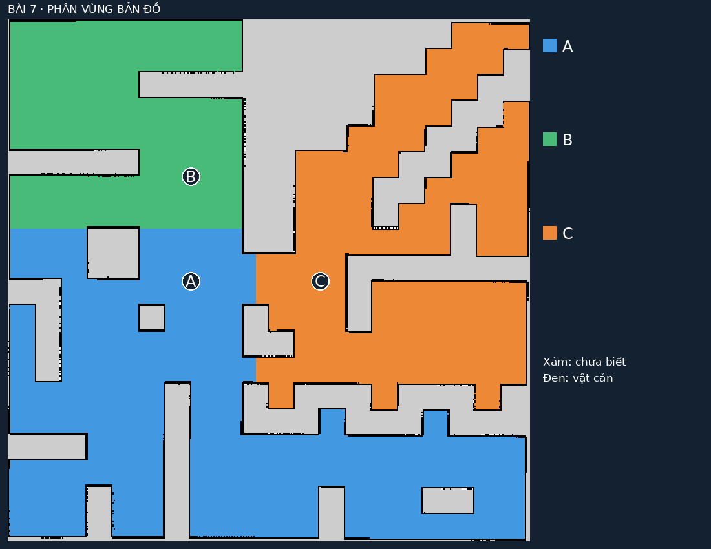
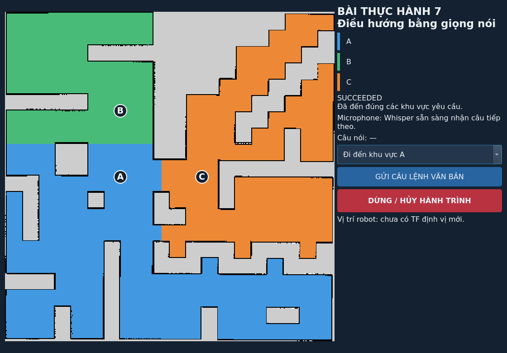

# Bài 7 — Kết quả kiểm chứng ngày 08/11/2026

Ubuntu 22.04, ROS 2 Humble, Gazebo Fortress, TurtleBot 4 Lite, world `maze`,
`maps/map.yaml`. Runtime kiểm tra ở ROS domain 57, Gazebo partition riêng.

| Nội dung | Kết quả | Bằng chứng |
|---|---|---|
| Build package và tích hợp launch | Đạt | `colcon build` với `turtlebot4_lab`, `turtlebot4_voice_nav` |
| Unit test | 50 đạt, 0 lỗi, 0 bỏ qua | `artifacts/voice_nav/unit_tests.xml` |
| Phân vùng | 3 vùng có nhãn A/B/C, goal có clearance ≥ 0.30 m | `artifacts/voice_nav/regions.yaml`, `segmented_map.png` |
| LiDAR | 640 range hữu ích | `navigation_validation.json` |
| Nav2 qua lệnh văn bản | A → B đúng thứ tự; đến phòng thí nghiệm, hành lang; 0 lần phát hiện bumper trong lượt này | `navigation_validation.json` |
| Khu vực không tồn tại | `Đi đến khu vực Z` → `UNKNOWN_REGION` | Cùng báo cáo Nav2 |
| Câu phủ định | `không đi đến A` → `UNKNOWN_COMMAND` | Cùng báo cáo Nav2 |
| Lệnh mới khi bận | `BUSY`, không thay hành trình đang chạy | Cùng báo cáo Nav2 |
| Hủy hành trình | Action status 5 (`CANCELED`), odometry về gần 0 | Cùng báo cáo Nav2 |
| Whisper từ WAV | Nhận đúng 3 câu, confidence khoảng 0.777 / 0.841 / 0.779 | `speech/speech_validation.json` |
| Toàn tuyến WAV → Whisper → ROS → Nav2 | Cả 3 câu đến A/B/C, action status 4 | `voice_pipeline_validation.json` |
| Mở microphone thật | Thu được 44.100 mẫu, 44.1 kHz trong 1 giây | `microphone_validation.json` |
| Giọng người thật nói ba câu trực tiếp | **Chưa kiểm chứng** | Cần thực hiện khi nghiệm thu |

Các đường dẫn bằng chứng trong bảng thuộc `artifacts/voice_nav/`.

Ảnh dashboard được cập nhật sau khi rút gọn nhãn thành A/B/C. Khi có TF mới,
giao diện hiển thị vị trí từ AMCL; khi chưa có TF mới sẽ báo rõ trạng thái đó.
Ảnh giao diện chỉ minh họa cách hiển thị; kết quả điều hướng nằm trong các
báo cáo JSON bên dưới.

## Kết quả toàn tuyến âm thanh

WAV là giọng tổng hợp Google TTS từ ba câu demo công khai, không phải bản ghi
người dùng. Mỗi WAV được nạp bằng node `speech` thực, chạy Whisper Small CPU
int8 offline; node công bố `/voice_nav/transcript`, navigator phân tích rồi gửi
action Nav2. Không inject trực tiếp nhãn A/B/C để thay cho nhận dạng.

| Câu WAV | Transcript toàn tuyến | Đích | Pose AMCL khi action thành công | Sai số vị trí so với goal |
|---|---|---|---|---|
| Đi đến phòng học | Đi đến phòng học. | A | (-2.810, -0.067) m | khoảng 0.201 m |
| Đi đến phòng thí nghiệm | Đi đến phòng thí nghiệm. | B | (-2.885, 3.794) m | khoảng 0.236 m |
| Đi đến hành lang | Đi đến Hành lang. | C | (1.777, 0.106) m | khoảng 0.247 m |

Đây là sai số theo pose định vị AMCL; không phải phép đo ground truth độc lập.
Tất cả nằm trong goal tolerance Nav2 đang sử dụng. Lượt C → A đầu mất khoảng
129 giây; log Create3 có phản xạ tự động xen vào trước khi đến đích. Báo cáo
WAV không đếm bumper; kết luận **0 bumper** chỉ áp dụng lượt Nav2 văn bản ở
trên. Timeout mỗi goal mặc định 240 giây sẽ hủy hành trình nếu quá hạn.

Whisper dùng danh sách tên địa điểm từ YAML làm ngữ cảnh từ vựng, vẫn cho phép
nhận tên không tồn tại để parser từ chối. Cần kiểm tra thêm giọng vùng miền,
tiếng nền, chữ A/B/C và câu dài trên microphone thực. Việc mở được microphone
chỉ xác nhận đường thu PCM, không chứng minh nhận đúng lời nói của người dùng.

## Những vấn đề đã xử lý trong triển khai

- Sandbox cấm socket ROS/Gazebo và IPC âm thanh: runtime được chạy ngoài
  sandbox sau khi có quyền thực thi.
- Gazebo headless cần đường dẫn plugin ROS: dùng launch `ros_gz_sim` chính
  thức để nạp `ign_ros2_control` thay vì gọi server thiếu môi trường plugin.
- Một lần Nav2 domain 49 bị kẹt ở lifecycle configuration sau service response
  timeout. Phiên domain 57/partition riêng khởi động và chạy thành công; helper
  `voice_nav_env.bash` dùng cấu hình riêng này cho Bài 7.
- Vosk tiếng Việt nhỏ nhận sai các WAV tổng hợp. Chuyển backend mặc định sang
  Whisper Small; Vosk vẫn là tùy chọn để thực nghiệm độ trễ/độ chính xác.
- Kiểm thử hủy bao gồm thời điểm chưa có goal handle, goal bị từ chối,
  action lỗi và kết quả thành công tới sát thời điểm hủy; không gửi chặng kế
  tiếp khi đã yêu cầu dừng.

Xem [hướng dẫn chạy và lệnh kiểm thử](../README_VOICE_NAV.md) để tái lập.

## Bổ sung ngày 10/11/2026 — microphone laptop

Đã xác nhận nguồn thu `alsa_input.pci-0000_05_00.6.analog-stereo` dùng cổng
`analog-input-internal-mic`, không mute. Mức khuếch đại ban đầu làm tín hiệu
clipping và bộ tách câu báo câu dài liên tục. Sau khi giảm Internal Mic Boost
về 0 dB và Capture về 54/63, mẫu thu có RMS khoảng 224, peak 701 và không có
mẫu clipping. Chỉ lưu thống kê, không lưu âm thanh người dùng.

Đã bổ sung timeout/thử lại khi truy vấn lifecycle Nav2 không nhận được phản
hồi, tránh navigator mắc kẹt ở WAITING. Bộ kiểm thử hiện có **52 test đạt**.
Đường thu trực tiếp dùng microphone; WAV vẫn là đầu vào riêng của bộ kiểm
chứng. Việc nhận đúng câu nói của người dùng cần đối chiếu trực tiếp trên GUI.

Thông số đo: `artifacts/voice_nav/microphone_setup_20261110.json`.
