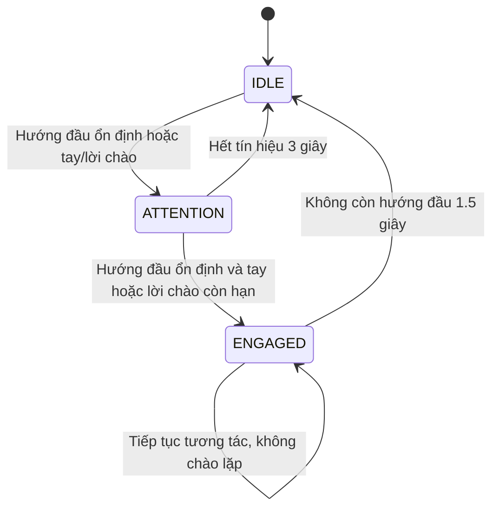

# Bài 02 — Robot nhận biết ý định bắt đầu tương tác

Package ROS 2 Humble `hri_engagement` kết hợp **hướng đầu + giơ tay chào + lời chào** để phân biệt người muốn tương tác với người chỉ nhìn/đi ngang. Package chạy độc lập trong workspace, không cần Gazebo.

## Chạy nhanh

```bash
cd /home/linh/ros2_ws
source /opt/ros/humble/setup.bash
# Bỏ qua bước cài nếu .venv-gesture đã có MediaPipe 0.10.21.
bash src/hri_engagement/scripts/setup_camera.bash
colcon build --symlink-install --packages-select hri_engagement
./run_engagement.bash
```

Cửa sổ webcam hiển thị hướng đầu, tay, trạng thái FSM và lời chào của robot. Đứng một người trước webcam, nhìn thẳng về phía camera rồi giơ bàn tay mở gần đầu, giữ khoảng 0,5–1 giây. Robot chuyển `IDLE → ATTENTION → ENGAGED` và chào một lần. Nhấn **Q/Esc** hoặc Ctrl-C để dừng.

Trong terminal thứ hai, nhập lời chào thay cho giơ tay:

```bash
cd /home/linh/ros2_ws
source /opt/ros/humble/setup.bash
source install/local_setup.bash
export ROS_DOMAIN_ID=67 ROS_LOCALHOST_ONLY=1
ros2 run hri_engagement text_input
```

Nhập `Hello robot`, `Excuse me` hoặc `Xin chào robot` trong khi nhìn camera. Bài cho phép **text hoặc STT**; chế độ text hoạt động ngay. Có thể nối STT bên ngoài vào topic speech theo giao diện bên dưới. Package này không cài thêm bộ nhận dạng giọng nói.

## Logic tương tác



- Hướng đầu phải ổn định ít nhất **0,4 giây**, ≥4 frame và ≥75% số frame trong cửa sổ 0,6 giây. Chỉ nhìn robot sẽ dừng ở `ATTENTION`.
- Giơ bàn tay mở gần đầu ít nhất **0,3 giây** tạo một tín hiệu chào. Không yêu cầu lắc tay: đề bài yêu cầu nhận biết **giơ tay chào**. Giữ tay liên tục không làm mới sự kiện mãi mãi; hạ rồi giơ lại để tạo sự kiện mới.
- Tay và lời chào có hiệu lực **2,5 giây** để kết hợp với hướng đầu. Lời chào có thể đến trước hướng đầu. STT cần confidence ≥0,65; text được xem như confidence 1.
- Chuyển vào `ENGAGED` phát lời chào một lần. Người vẫn nhìn robot thì phiên tương tác tiếp tục. Rời hướng nhìn 1,5 giây kết thúc phiên; hai lần chào cách nhau ít nhất 5 giây.
- Camera mất frame quá **0,7 giây** hoặc báo lỗi: trở về `IDLE`, xóa tín hiệu đã lưu, chờ tín hiệu mới. Frame hợp lệ không có người vẫn là camera khỏe.
- Nhận hơn một khuôn mặt: không xác nhận hướng đầu/tay để tránh ghép nhầm người. Mô hình dành cho **một người tương tác tại một thời điểm**.

MediaPipe Face Mesh cung cấp landmark; OpenCV `solvePnP` ước lượng pitch/yaw từ mô hình mặt 6 điểm và camera xấp xỉ. Đây là **hướng đầu**, không phải đo ánh mắt. Cần chỉnh ngưỡng theo camera; góc mặc định ±22°. Hướng dẫn nền tảng: [Face Mesh](https://github.com/google-ai-edge/mediapipe/blob/master/docs/solutions/face_mesh.md), [Hands](https://github.com/google-ai-edge/mediapipe/blob/master/docs/solutions/hands.md). Pin MediaPipe 0.10.21 vì package dùng API `mp.solutions`.

## Launch và cấu hình

```bash
./run_engagement.bash camera_index:=0 yaw_limit:=25.0 pitch_limit:=25.0
./run_engagement.bash show_window:=false output_dir:="$PWD/artifacts/hri_engagement/camera"
# Controller để kết nối nguồn quan sát bên ngoài / kiểm thử:
./run_engagement.bash camera:=false
```

Runner đặt ROS domain **67**, localhost-only. Đổi bằng `ENGAGEMENT_DOMAIN_ID=68 ./run_engagement.bash`; các terminal khác phải dùng cùng domain. Các bộ đếm và thời hạn dùng thời gian monotonic, không bị clock mô phỏng làm dừng.

`config/engagement.yaml` chứa tham số FSM. Truyền bản cấu hình riêng bằng `config:=/đường/dẫn/engagement.yaml`. Các tham số được đọc khi khởi động; khởi chạy lại sau khi đổi. `camera_python` là Python có ROS, OpenCV và MediaPipe; runner chọn `.venv-gesture/bin/python` đã có trong workspace. Script setup dùng chung môi trường và cùng phiên bản thư viện với package gesture hiện tại.

## Giao diện ROS

| Topic/service | Kiểu | Nội dung |
|---|---|---|
| `/engagement/vision` | `std_msgs/String` | JSON `healthy`, `face_present`, `facing`, `hand_raised`: bắt buộc boolean; camera có thêm góc và số khuôn mặt |
| `/engagement/speech` | `std_msgs/String` | Text thuần hoặc JSON `{"text":"Hello robot","confidence":0.9}` từ STT |
| `/engagement/state` | `std_msgs/String` | JSON trạng thái, lý do, tín hiệu đã lọc, sức khỏe camera, số lần chào; 20 Hz |
| `/engagement/events` | `std_msgs/String` | JSON mỗi lần trạng thái/lý do thay đổi |
| `/engagement/response` | `std_msgs/String` | `Xin chào! Tôi có thể giúp gì cho bạn?`, phát một lần lúc vào ENGAGED |
| `/engagement/image/compressed` | `sensor_msgs/CompressedImage` | Webcam có chú thích |
| `/engagement/reset` | `std_srvs/Trigger` | Reset FSM, bộ đếm và cooldown để bắt đầu lượt thử độc lập |

```bash
ros2 topic echo /engagement/state
ros2 topic echo /engagement/response
ros2 topic pub --once /engagement/speech std_msgs/msg/String '{data: "Hello robot"}'
ros2 service call /engagement/reset std_srvs/srv/Trigger '{}'
```

Lời chào xuất hiện ở preview, terminal và topic response; có thể nối topic này với loa/TTS của robot. Package không điều khiển vận tốc robot.

## Nộp bài: video và ít nhất 15 lượt thử

Kế hoạch 15 lượt ở `data/trial_plan.csv`. Tạo video bằng:

```bash
./run_engagement.bash output_dir:="$PWD/artifacts/hri_engagement/camera"
```

Mỗi lần chạy tạo một thư mục riêng gồm `webcam.avi` có chú thích và `observations.jsonl` gồm quan sát và lời chào. Video ghi 15 fps cố định; nếu máy xử lý chậm thì tốc độ phát không phản ánh chính xác thời gian thực, dùng timestamp JSONL để đo thời gian. Thoát bằng Q/Ctrl-C để đóng video đúng cách.

Quay tối thiểu 3 tình huống: **chỉ nhìn (không chào)**, **nhìn + giơ tay (chào)**, **nhìn + lời chào (chào)**. Bổ sung đi ngang để kiểm tra chào nhầm. Để nhập text đồng thời ghi video, dùng terminal thứ hai như phần chạy nhanh.

Trong terminal đã source và đặt domain, ghi mỗi lượt bằng lệnh sau (thay scenario/expected theo kế hoạch):

```bash
ros2 run hri_engagement trial_recorder \
  --scenario look_only --expected no --duration 8 \
  --video artifacts/hri_engagement/camera/THU_MUC_RUN/webcam.avi

ros2 run hri_engagement trial_recorder --scenario head_hand --expected yes --duration 8
ros2 run hri_engagement trial_recorder --scenario head_speech --expected yes --duration 8
ros2 run hri_engagement trial_recorder --scenario passerby --expected no --duration 8
```

Mỗi lệnh chờ 3 giây chuẩn bị, reset FSM, chờ frame camera mới (tối đa 3 giây) rồi bắt đầu cửa sổ đo. Hạ tay và quay khỏi camera lúc chuẩn bị, thực hiện tình huống khi terminal báo **BẮT ĐẦU**. Kết quả được append vào `artifacts/hri_engagement/live_trials.csv`; lượt bị mất camera được đánh dấu invalid và loại khỏi phép đo. Khi camera không mất frame nhưng không nhận ra mặt, lượt đó vẫn hợp lệ và có thể là false negative. Nếu dùng nguồn vision mô phỏng, truyền `--source synthetic --output artifacts/hri_engagement/recorder_synthetic.csv` để ghi đúng loại dữ liệu.

**Tỷ lệ chào nhầm = FP / (FP + TN)**: số lượt robot chào dù không có ý định tương tác chia tổng lượt không có ý định. Công cụ cũng tính TP/FN và accuracy. Không trộn dữ liệu synthetic với live. Thử lại đủ số lượt hợp lệ nếu gặp camera lỗi. Video người thật và bảng live cần được thực hiện trực tiếp; các kết quả synthetic không thay thế hai phần này.

## Kiểm tra

```bash
cd /home/linh/ros2_ws
PYTHONPATH=src/hri_engagement .venv-gesture/bin/python -m unittest discover -s src/hri_engagement/test -v
source /opt/ros/humble/setup.bash
source install/local_setup.bash
ros2 run hri_engagement replay_trials --output artifacts/hri_engagement/synthetic_trials.csv
ROS_DOMAIN_ID=168 ROS_LOCALHOST_ONLY=1 python3 src/hri_engagement/test/check_runtime.py
```

Replay tạo 15 lượt **synthetic** từ boolean, không cần camera và không xác minh chất lượng nhận dạng người thật. Chọn output mới nếu file đã có. Runtime checker tự khởi chạy controller bằng launch với camera tắt, kiểm tra topic/service thực tế và dừng tiến trình của chính nó. Xem kết quả đã chạy trong `VALIDATION.md`.

## Khắc phục lỗi

- Không mở được camera: kiểm tra `/dev/video*`, thử `camera_index:=2`; đóng ứng dụng đang giữ webcam.
- `No module named mediapipe` hoặc thiếu `mp.solutions`: dùng script setup và runner, không chạy camera bằng Python hệ thống chưa cài thư viện.
- Camera nhận mặt nhưng `head=False`: đặt camera ngang tầm mặt, đủ sáng, nhìn thẳng và xem pitch/yaw; chỉnh ngưỡng launch. Mô hình mặt/camera xấp xỉ có sai lệch theo người và ống kính.
- Tay không nhận: mở 4 ngón, đưa cổ tay cao hơn cằm và gần khuôn mặt, giữ ít nhất 0,5 giây; tránh che mặt. Ghép tay với mặt chỉ dựa vị trí ảnh, không có theo dõi danh tính.
- Không nhận text hoặc không thấy topic: source `install/local_setup.bash` và kiểm tra cùng `ROS_DOMAIN_ID=67`, `ROS_LOCALHOST_ONLY=1`.
- Lỗi Qt/GTK khi chạy từ VS Code Snap: dùng `run_engagement.bash` để xóa các biến loader của Snap; dùng `show_window:=false` để chạy headless.
